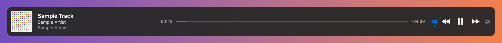
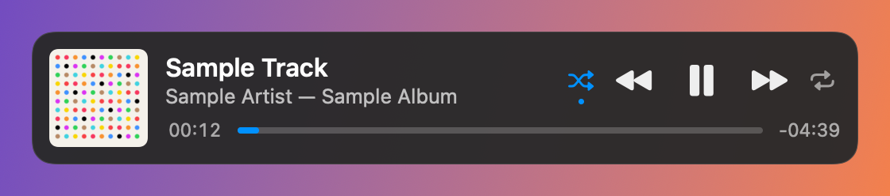

# NowBar

An always-on Now Playing bar for Spotify on macOS.



The macOS Now Playing widget is great, but it lives in a menu you have to open. NowBar keeps the same
information on screen as a bar you can put anywhere: album art, title, artist and album, a scrubber,
and shuffle / previous / play-pause / next / repeat. It appears when Spotify opens and fades away
when Spotify quits. It never relaunches Spotify after you've quit it.

Narrow it down and it switches to a two-line layout:



Native Swift (AppKit + SwiftUI), Apple Silicon, macOS 14 or later. Not affiliated with Spotify.

## Features

- **Move** it by dragging. **Resize** it from the left or right edge for width, or the bottom edge for
  height. Everything scales with it.
- **Seek** by clicking or dragging the scrubber. **Click the artwork** to bring Spotify to the front.
- **On top of windows**, or **on the desktop, behind windows**.
- **On every desktop (Space)**, or kept on one. To move it, go to the desktop you want and choose
  *Move Bar to This Desktop*.
- **Lock** position and size, **reset** them (to the screen the pointer is on), and **open at login**.
- Clicking the bar never takes focus from the app you're typing in.
- All options are in the menu bar icon, the Dock icon's right-click menu, and a right-click on the
  bar itself. Clicking the Dock icon brings the bar back (and opens Spotify if it's closed).

## Install

There's no prebuilt download. Build it from source. Only the Xcode Command Line Tools are needed
(`xcode-select --install`).

```bash
git clone https://github.com/nathanm95/nowbar.git
cd nowbar
scripts/make-signing-identity.sh   # once; see "Code signing" below
scripts/build.sh --install         # builds and copies to /Applications/NowBar.app
open /Applications/NowBar.app
```

The first time, macOS asks whether NowBar may control Spotify. Allow it. If you said no, turn it on
in **System Settings › Privacy & Security › Automation › NowBar › Spotify**.

### Code signing

macOS ties the "control Spotify" permission to the app's code signature. An ad hoc signed build gets
a new signature every time, so you'd be asked again after each rebuild.
`scripts/make-signing-identity.sh` creates a self-signed "NowBar Local Signing" identity in your
login keychain, and `build.sh` uses it automatically. The certificate only works on the Mac that
made it. To sign with something else, set `NOWBAR_SIGN_IDENTITY`, either in your environment or in a
git-ignored `scripts/local.env`.

## How it works

- `SpotifyClient.swift` reads Spotify through its AppleScript dictionary: one compiled script for the
  state, and one-liners for commands. Every script checks Spotify is running before it talks to it.
  Spotify's `com.spotify.client.PlaybackStateChanged` distributed notification triggers an instant
  refresh. A 2-second poll catches seeks, shuffle and repeat, and the clock between polls is counted
  locally. Polling stops while the bar is hidden.
- `BarWindow.swift` holds a borderless, non-activating `NSPanel` over an `NSVisualEffectView`.
  Hiding fades the panel out rather than closing it, so it stays on the desktop you put it on.
- `BarView.swift` is the SwiftUI layout. Moving and resizing work from the pointer's screen position
  rather than the window's built-in dragging, so dragging the scrubber never drags the window.

## Notes and gotchas

- With only the Command Line Tools (no Xcode), SwiftUI's `@State` macro doesn't compile because the
  macro plugin is missing. The code uses `@ViewState`, an alias for the plain `SwiftUI.State`
  property wrapper.
- Spotify's scripting dictionary says `duration` is in seconds. It's in milliseconds.
- `st`, `nd`, `rd` and `th` are reserved words in AppleScript (ordinals), so don't use them as
  variable names.
- macOS has no public API to put a window on a particular desktop, so after a restart the bar starts
  on whichever desktop is active. Use *Move Bar to This Desktop* or *Show on All Desktops*. Or try
  the Dock icon's **Options › Assign To** to bind NowBar to one desktop.

## Debugging

```bash
# PNGs of every layout and state, with sample data. Needs no Spotify and no permissions.
build/NowBar.app/Contents/MacOS/NowBar --render-test /tmp/nowbar-render

# Run against the real Spotify, writing state.txt and bar.png after every refresh.
open /Applications/NowBar.app --args --dump /tmp/nowbar-live
```

## Licence

MIT. See [LICENSE](LICENSE).
